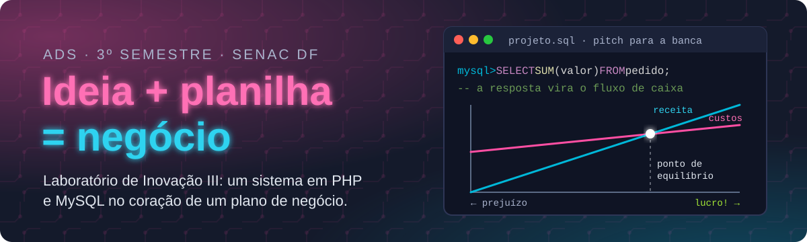

<p align="center">
  
</p>

<p align="center">
  
  
  
  
</p>

<p align="center">
  <b><a href="https://maristelaoliveira.github.io/lab-inovacao-3/">🌐 Abrir o site da disciplina</a></b>
  &nbsp;·&nbsp;
  <b><a href="https://maristelaoliveira.github.io/lab-inovacao-3/#aulas">📚 Ir direto para as aulas</a></b>
  &nbsp;·&nbsp;
  <b><a href="https://maristelaoliveira.github.io/lab-inovacao-3/aulas/aula-12.html">🛠️ Tutorial do protótipo em PHP e MySQL</a></b>
</p>

---

## `mysql> SELECT * FROM ideias WHERE vira_negocio = 1;`

Prazer, eu sou a **Profa. Maristela**, ou só **Stela**! 👋

Boas-vindas ao **Laboratório de Inovação III**, do curso de **Análise e Desenvolvimento de Sistemas** da Faculdade de Tecnologia e Inovação Senac DF (3º semestre, noturno, Taguatinga, 70 horas).

Aqui o código encontra o mercado. Cada grupo parte de um problema real e desenvolve um **sistema com banco de dados**, usando o PHP e o MySQL da Web II. Esse sistema vira o coração de um **plano de negócio de base tecnológica**, com números de verdade e um **pitch para a banca**.

Este repositório é o **site da disciplina**: o lugar onde ficam as aulas, os tutoriais, os estudos de caso e tudo o que a gente usa no semestre. Nada de slides: aqui a aula é o próprio site.

```sql
mysql> SELECT ideia, cliente, sistema, conta_fecha
    ->   FROM projeto
    ->  WHERE grupo = 'vocês';
+-------+---------+-------------+-------------+
| ideia | cliente | sistema     | conta_fecha |
+-------+---------+-------------+-------------+
| boa   | real    | PHP + MySQL | SIM         |
+-------+---------+-------------+-------------+
1 row in set: um negócio de pé. 🚀
```

> 💡 Ideia sem planilha é sonho. Planilha sem ideia é só conta.

---

## 🧭 O que tem no site

| | Seção | Para que serve |
|:-:|---|---|
| 🔬 | **O projeto** | O raio-x do tema: Business Model Canvas, MVP, ponto de equilíbrio, payback e o ecossistema de quem empreende. |
| 📜 | **Ementa e objetivos** | A ementa oficial, palavra por palavra. Muita coisa, sim. Mas é tudo para o mesmo projeto. |
| 🗺️ | **Quatro unidades** | Empreendedorismo, gestão de projetos, implantação do negócio e análise financeira. |
| 📚 | **Aulas** | As 18 páginas, com conceitos, estudo de caso, atividade e checklist. |
| 🛠️ | **Tutoriais passo a passo** | Nas aulas 11 a 15: análise de mercado, protótipo em PHP e MySQL e a planilha financeira. |
| 📊 | **Avaliação** | Como a nota é montada. Spoiler: não tem prova, a nota vem do projeto. |
| 📖 | **Bibliografia** | Os livros para ir além da aula. |
| ♿ | **Acessibilidade** | Tema claro e escuro, aumento de texto (A+) e botão para pausar as animações. |

---

## 🗺️ A trilha do semestre

Quatro unidades, um negócio. Cada unidade monta uma parte do plano. No fim, elas se encaixam no pitch:

```php
<?php
$trilha = [
    "Unidade 1 · aulas 2 a 4"   => "empreendedorismo e oportunidades",
    "Unidade 2 · aulas 5 a 9"   => "atividade interdisciplinar e gestão de projetos",
    "Unidade 3 · aulas 10 a 12" => "implantação de um novo empreendimento",
    "Unidade 4 · aulas 13 a 15" => "análise financeira do plano de negócio",
];

foreach ($trilha as $unidade => $peca) {
    echo "🧩 $unidade: $peca\n";
}

echo "🎤 Pitch pronto para a banca!";
```

| Aula | Tema | |
|:-:|---|:-:|
| 01 | Conhecendo o Laboratório de Inovação III | [abrir](https://maristelaoliveira.github.io/lab-inovacao-3/aulas/aula-01.html) |
| 02 | Eu tenho perfil empreendedor? | [abrir](https://maristelaoliveira.github.io/lab-inovacao-3/aulas/aula-02.html) |
| 03 | Caçando oportunidades | [abrir](https://maristelaoliveira.github.io/lab-inovacao-3/aulas/aula-03.html) |
| 04 | Do problema ao negócio: o Business Model Canvas | [abrir](https://maristelaoliveira.github.io/lab-inovacao-3/aulas/aula-04.html) |
| 05 | Gestão de projetos I: o termo de abertura | [abrir](https://maristelaoliveira.github.io/lab-inovacao-3/aulas/aula-05.html) |
| 06 | Gestão de projetos II: cronograma e riscos | [abrir](https://maristelaoliveira.github.io/lab-inovacao-3/aulas/aula-06.html) |
| 07 | Execução e relatório parcial | [abrir](https://maristelaoliveira.github.io/lab-inovacao-3/aulas/aula-07.html) |
| 08 | Apresentação parcial do projeto | [abrir](https://maristelaoliveira.github.io/lab-inovacao-3/aulas/aula-08.html) |
| 09 | Entrega do 1º bimestre: registro no Loop e no README.md | [abrir](https://maristelaoliveira.github.io/lab-inovacao-3/aulas/aula-09.html) |
| 10 | Os passos para implantar um novo empreendimento | [abrir](https://maristelaoliveira.github.io/lab-inovacao-3/aulas/aula-10.html) |
| 11 | Plano de negócio I: mercado e marketing 🛠️ | [abrir](https://maristelaoliveira.github.io/lab-inovacao-3/aulas/aula-11.html) |
| 12 | Plano de negócio II: operações e protótipo 🛠️ | [abrir](https://maristelaoliveira.github.io/lab-inovacao-3/aulas/aula-12.html) |
| 13 | Análise financeira I: investimento, custos e fluxo de caixa 🛠️ | [abrir](https://maristelaoliveira.github.io/lab-inovacao-3/aulas/aula-13.html) |
| 14 | Análise financeira II: ponto de equilíbrio e índices 🛠️ | [abrir](https://maristelaoliveira.github.io/lab-inovacao-3/aulas/aula-14.html) |
| 15 | Análise de sensibilidade 🛠️ | [abrir](https://maristelaoliveira.github.io/lab-inovacao-3/aulas/aula-15.html) |
| 16 | Relatório final e ensaio do pitch | [abrir](https://maristelaoliveira.github.io/lab-inovacao-3/aulas/aula-16.html) |
| 17 | Apresentação do projeto final | [abrir](https://maristelaoliveira.github.io/lab-inovacao-3/aulas/aula-17.html) |
| 18 | Avaliação final de recuperação | [abrir](https://maristelaoliveira.github.io/lab-inovacao-3/aulas/aula-18.html) |

🛠️ = aula com tutorial passo a passo.

---

## 🛠️ Mão na massa: os tutoriais

Nas aulas 11 a 15, a seção **Tutorial** mostra cada passo numa caixa **Faça assim**, com testes no caminho e um **Agora é com você** para o grupo aplicar no próprio negócio. Os blocos de código vêm completos, com botão de copiar. O exemplo que acompanha tudo é o **Lanche Já**, a lanchonete do campus com pedido antecipado pelo celular (o caso da aula 4).

| Aula | Tutorial | Ferramentas |
|:-:|---|---|
| 11 | A análise de mercado em 5 passos: ficha do cliente, pesquisa, concorrentes e os 4 Ps | Loop, Microsoft Forms, Copilot |
| 12 | O protótipo com PHP e MySQL em 6 passos: do banco ao CRUD | XAMPP, MySQL, PHP, VS Code, GitHub |
| 13 | A planilha financeira em 5 passos: investimento, custos, receitas e fluxo de caixa | Excel, Copilot |
| 14 | Os indicadores e o painel em 5 passos: ponto de equilíbrio, lucratividade, rentabilidade e payback | Excel, Power BI |
| 15 | Os três cenários em 5 passos: pessimista, realista e otimista | Excel |

> 📎 A [planilha modelo do Lanche Já](https://maristelaoliveira.github.io/lab-inovacao-3/assets/arquivos/Lanche-Ja-planilha-modelo.xlsx) tem as abas das aulas 13, 14 e 15 prontas. Montem a de vocês primeiro e usem a modelo só para conferir. Copiar o gabarito antes é spoiler de filme que vocês mesmos vão dirigir. 🎬

---

## 🛠️ Ferramentas da disciplina

<p align="center">
  
</p>

| Ferramenta | Para quê |
|---|---|
| 🐘 **PHP** e 🐬 **MySQL** | O sistema do grupo, do modelo do banco ao CRUD. |
| 🧰 **XAMPP** | Rodar o PHP e o MySQL no computador (`http://localhost/phpmyadmin`). |
| 📗 **Excel** e **Copilot do Microsoft 365** | A planilha financeira, os indicadores e os cenários. |
| 📈 **Power BI** | O painel com os indicadores do negócio. |
| 📝 **Microsoft Forms** | A pesquisa de mercado com quem importa: o cliente. |
| 💬 **Teams, Loop e Whiteboard** | Combinar, registrar as entregas e trabalhar junto. |
|  **GitHub** e **GitHub Copilot** | Guardar o código do protótipo e ter ajuda para programar. |
| 🎓 **Moodle** | Entregar as atividades. |

---

## 🤖 IA com consciência

O Copilot do Microsoft 365 ajuda na pesquisa de mercado, na escrita e nas planilhas. O GitHub Copilot ajuda no protótipo. **Quem valida tudo são vocês.**

> 🧮 A IA monta a fórmula em segundos. Mas, se o ponto de equilíbrio der 3 lanches por mês, alguém precisa desconfiar. E esse alguém é você.

---

## 📊 Como a nota é montada

Dez pontos por bimestre. Aqui não tem prova: a nota vem do projeto.

| 1º bimestre (10 pontos) | | 2º bimestre (10 pontos) | |
|---|:-:|---|:-:|
| Apresentação parcial do projeto | 4,0 | Apresentação do projeto final | 7,0 |
| Entregas com explicação no Loop e no README.md | 6,0 | Avaliação Integrada | 2,0 |
| | | Participação na Jornada Interdisciplinar | 1,0 |

Para ser aprovado: **média final 6,0** e pelo menos **75% de frequência**.

```text
mysql> SELECT aprovado FROM aluno WHERE frequencia < 0.75;
Empty set (0.00 sec)
```

> Nesse `SELECT` ninguém quer aparecer. Venha às aulas! 😉

---

## 🙋 Dicas de sobrevivência

1. **Comece pequeno, aprenda rápido.** O MVP é a versão mais simples que já dá para testar com cliente de verdade. Errar cedo sai barato.
2. **Converse com o cliente antes de criar a tabela.** Banco de dados bonito sem cliente é só um `CREATE TABLE` solitário.
3. **Commit pequeno e frequente.** Com nome de quem fez o quê.
4. **Teste o pior caso.** O cenário pessimista existe para o seu negócio não ser pego de surpresa.
5. **Travou?** Pergunte no Teams. Nenhum unicórnio nasceu sem um `Fatal error` no caminho. 🦄

---

<details>
<summary><b>👩‍🏫 Para a professora (estrutura do repositório)</b></summary>

<br>

Site estático publicado no GitHub Pages a partir da branch `main`, sem build e sem dependências.

```text
lab-inovacao-3/
├── index.html              # página da disciplina (projeto, ementa, unidades, aulas, avaliação, bibliografia)
├── aulas/
│   └── aula-NN.html        # uma página por aula (01 a 18); tutoriais nas aulas 11 a 15 (section#na-tela)
└── assets/
    ├── arquivos/           # Lanche-Ja-planilha-modelo.xlsx (abas das aulas 13, 14 e 15)
    ├── css/  js/           # visual comum dos sites da Stela; aula.css, aulas.js e copiar-codigo.js (botão Copiar)
    └── img/                # ícones das tecnologias (tec/), logo, a lâmpada e o banner deste README
```

- Tutorial novo: siga o padrão das aulas 11 a 15 (`section.parte#na-tela`, um bloco `#passo-N` por passo, com as caixas `.faca-assim`). O código vai em `div.arquivo-codigo`, que ganha o botão Copiar.
- Os arquivos do visual comum (estilo.css, neon.css, placa.js…) são cópia do portal: edite lá.
- Antes de publicar: testar no navegador, também na largura de celular (390 px).

</details>

---

<p align="center">
  Feito com ♥ e sucata eletrônica pela <a href="https://maristelaoliveira.github.io/">Profa. Maristela</a> · Faculdade de Tecnologia e Inovação Senac DF
  <br>
  <code>ideia + planilha = negócio</code>
</p>
